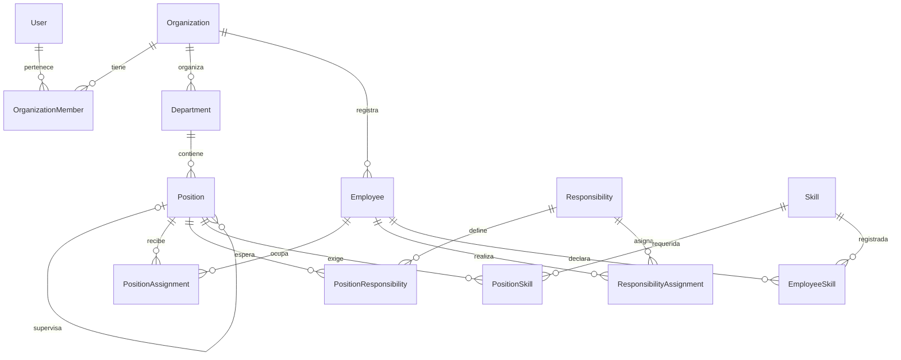
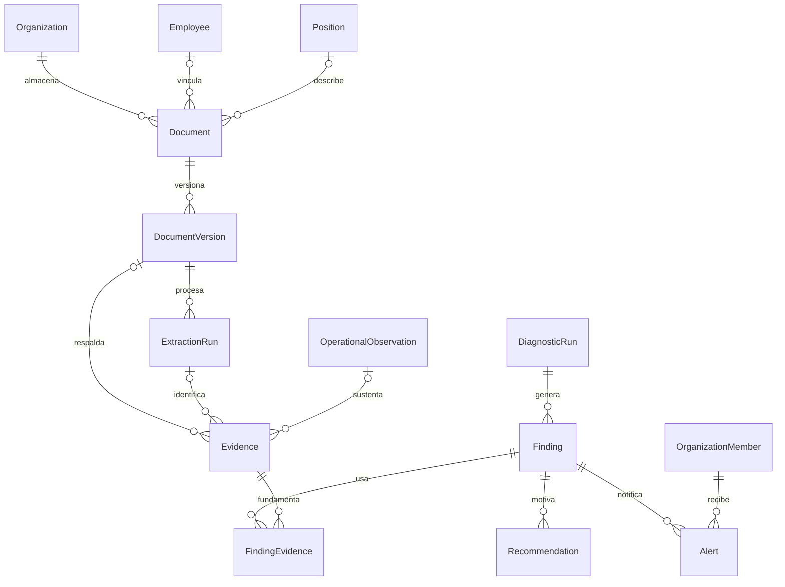
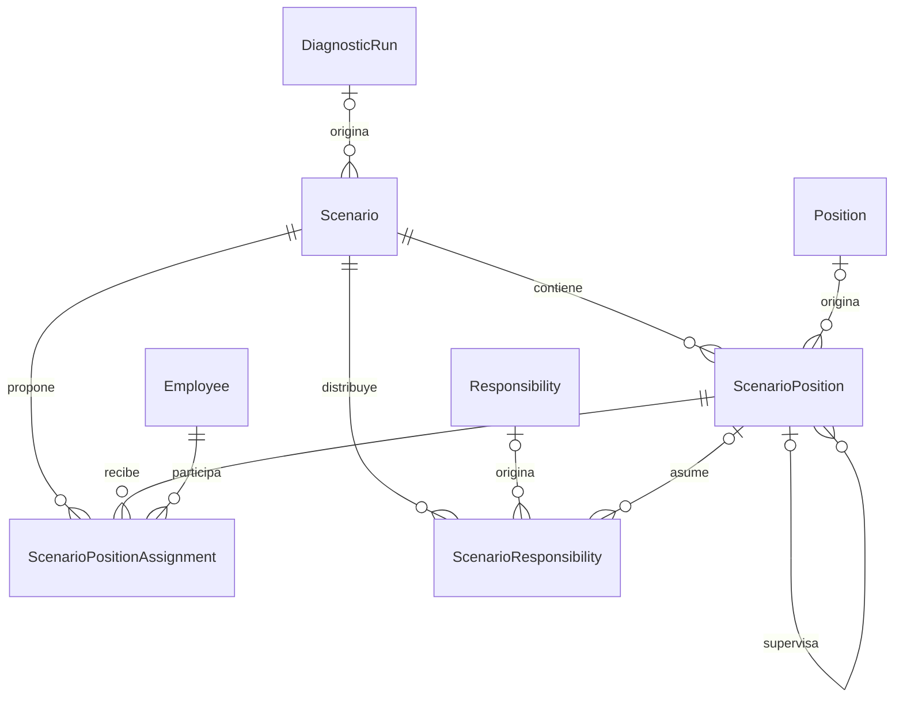

# Diseño de base de datos — Diagnóstico Organizacional Inteligente

Versión propuesta: 1.0 · Fecha: 12 de noviembre de 2026.

Estado: implementado. El esquema está en `api/prisma/schema.prisma` y se aplicó con la migración `20261112230000_init` (`api/prisma/migrations/`). Ante cualquier diferencia, Prisma es la fuente de verdad.

## 1. Alcance y decisiones

Motor: PostgreSQL. ORM y migraciones: Prisma. Backend propietario de los datos: NestJS. Autenticación prevista: Supabase Auth. Archivos: almacenamiento privado externo a PostgreSQL.

El sistema administra empresas, estructura organizacional, funciones, competencias, documentos, extracciones, diagnósticos, recomendaciones y escenarios. El modelo distingue datos confirmados, evidencia documental e inferencias. Los resultados de IA no actualizan automáticamente la información confirmada.

Es un modelo relacional compartido entre empresas: cada registro de negocio tiene `organizationId`. Los trabajadores no son necesariamente usuarios de la aplicación. Un usuario puede pertenecer a varias empresas.

Un `Position` representa un puesto organizacional concreto que puede admitir varias personas, por ejemplo «Técnico de mantenimiento — Faena A». No representa una familia universal de profesiones. Dos puestos con el mismo nombre pueden existir en departamentos distintos y tienen códigos diferentes.

La jerarquía inicial permite un superior directo por puesto. No se modelan dependencias matriciales múltiples. Las personas pueden ocupar varios puestos y las funciones efectivas pueden diferir de las funciones esperadas.

Las entidades principales son relacionales. JSONB se reserva para entradas congeladas, salidas de proveedores, métricas variables y configuración versionada. No reemplaza relaciones entre personas, puestos, funciones y habilidades.

Se propone un diseño final de 28 tablas y una implementación por etapas. No se exige construirlas todas para el avance de hoy. Se excluyen nómina, reclutamiento, evaluaciones psicológicas, facturación SaaS y predicción de inventarios o ventas.

## 2. Convenciones y campos comunes

Los nombres de modelos y campos se expresan como se usarían en Prisma: modelos PascalCase y campos camelCase. Las tablas y columnas físicas se mapearán a snake_case mediante `@@map` y `@map`.

| Notación | PostgreSQL / Prisma | Significado |
|---|---|---|
| UUID | `uuid` / `String @db.Uuid` | Identificador generado con UUID; no es una autorización. |
| Texto(n) | `varchar(n)` / `String @db.VarChar(n)` | Texto de longitud limitada. |
| Texto | `text` / `String @db.Text` | Texto largo. |
| Entero | `integer` / `Int` | Conteos y escalas discretas. |
| Entero largo | `bigint` / `BigInt` | Tamaño de archivos en bytes. La API lo serializa como texto o número seguro. |
| Decimal(p,s) | `numeric(p,s)` / `Decimal @db.Decimal(p,s)` | Horas y mediciones sin redondeo binario. |
| Fecha | `date` / `DateTime @db.Date` | Día calendario, sin hora. |
| Instante | `timestamptz(3)` / `DateTime @db.Timestamptz(3)` | Instante almacenado en UTC y presentado en zona del usuario. |
| JSON | `jsonb` / `Json @db.JsonB` | Objeto con contrato de validación y versión. |
| Enum | Enum de PostgreSQL / enum de Prisma | Valores enumerados definidos en la sección 7. |
| `?` | Nullable | Admite NULL; sin `?` es obligatorio. |

**Bases de campos**, incluidas en las tablas que las declaran:

- `G` — global mutable: `id UUID PK`, `createdAt Instante DEFAULT now()`, `updatedAt Instante` actualizado por la aplicación/Prisma.
- `T` — empresa mutable: todos los campos de G más `organizationId UUID FK → Organization.id`.
- `I` — empresa inmutable: `id UUID PK`, `organizationId UUID FK`, `createdAt Instante DEFAULT now()`; sin `updatedAt`.

El identificador no se modifica. `createdAt` no es la fecha de vigencia laboral ni la fecha de una observación. Todos los campos adicionales son obligatorios salvo que lleven `?`.

Toda tabla T o I declara `UNIQUE(organizationId, id)`. Las referencias entre entidades de empresa utilizan claves foráneas compuestas `(organizationId, referenciaId)` para impedir referencias entre empresas. La referencia a la organización utiliza su PK simple. Las claves a `User` son globales. La FK de un actor apunta a `OrganizationMember` y conserva la pertenencia a la misma empresa.

Las fechas de asignación usan intervalos `[startDate, endDate)`: inicio incluido y término excluido; `endDate = NULL` significa vigencia abierta. Una asignación está vigente si `startDate <= fecha` y `endDate IS NULL OR fecha < endDate`.

## 3. Diccionario de datos

### 3.1 Identidad y acceso

#### 01. Organization → organizations

Entidad: empresa u organización analizada. Base G.

| Campo adicional | Tipo | Regla / propósito |
|---|---|---|
| name | Texto(160) | Nombre visible. |
| slug | Texto(100) | UNIQUE global, minúsculas; identificador de navegación. |
| legalName | Texto(200)? | Razón social, si se conoce. |
| industry | Texto(100)? | Sector declarado; no se utiliza como clasificación automática. |
| timezone | Texto(64) | DEFAULT `America/Santiago`; zona IANA válida. |
| archivedAt | Instante? | Empresa deshabilitada para operaciones nuevas. |

No se exige RUT para realizar un diagnóstico. Puede añadirse si un requisito posterior de identificación legal lo necesita.

#### 02. User → users

Entidad: cuenta de una persona que utiliza la aplicación. Base G.

| Campo adicional | Tipo | Regla / propósito |
|---|---|---|
| authSubject | UUID | UNIQUE; `sub` del proveedor Supabase Auth. Identificador externo lógico. |
| email | Texto(254) | Correo normalizado para visualización y contacto; no es la clave de autorización. |
| displayName | Texto(160) | Nombre visible. |
| disabledAt | Instante? | Bloqueo de acceso local. |

No almacena contraseñas ni tokens de acceso. Se conserva un ID interno independiente del ID del proveedor. La sincronización del correo no cambia la identidad. No se crea una FK Prisma hacia el esquema administrado por Supabase Auth.

#### 03. OrganizationMember → organization_members

Entidad: pertenencia y rol de un usuario dentro de una empresa. Base T.

| Campo adicional | Tipo | Regla / propósito |
|---|---|---|
| userId | UUID FK → User | Usuario miembro. |
| role | MemberRole | DEFAULT `VIEWER`. |
| status | MembershipStatus | DEFAULT `ACTIVE`. |

UNIQUE `(organizationId, userId)`. Un usuario puede pertenecer a muchas empresas. Un miembro revocado se conserva para mantener la autoría histórica. La aplicación garantiza que una empresa activa mantenga al menos un OWNER activo, considerando también el estado del usuario.

### 3.2 Estructura real y asignaciones

#### 04. Department → departments

Entidad: área, unidad, faena o departamento. Base T.

| Campo adicional | Tipo | Regla / propósito |
|---|---|---|
| code | Texto(40) | UNIQUE por empresa. |
| name | Texto(160) | Nombre del área. |
| description | Texto? | Alcance de la unidad. |
| parentDepartmentId | UUID? FK → Department | Unidad superior de la misma empresa. |
| archivedAt | Instante? | Archivo lógico. |

CHECK `parentDepartmentId <> id` cuando no sea NULL. Se impiden ciclos mediante validación transaccional. Archivar un departamento exige resolver sus puestos y subáreas activos; no los archiva silenciosamente.

#### 05. Position → positions

Entidad: puesto organizacional esperado. Base T.

| Campo adicional | Tipo | Regla / propósito |
|---|---|---|
| code | Texto(40) | UNIQUE por empresa. |
| title | Texto(160) | Nombre del puesto. |
| description | Texto? | Propósito y alcance. |
| departmentId | UUID FK → Department | Área propietaria. |
| parentPositionId | UUID? FK → Position | Superior directo; puede pertenecer a otra área de la misma empresa. |
| targetHeadcount | Entero | DEFAULT 1; CHECK >= 1. Personas objetivo; permite calcular vacantes. |
| criticality | Severity | DEFAULT `MEDIUM`; criterio organizacional declarado. |
| archivedAt | Instante? | Retiro lógico del puesto. |

La vacancia se deriva de `targetHeadcount` y asignaciones vigentes; no se almacena un booleano redundante. CHECK superior distinto de sí mismo y validación transaccional de ciclos. No se mantienen simultáneamente una tabla de jerarquías y `parentPositionId`.

#### 06. Employee → employees

Entidad: trabajador de la empresa, con o sin acceso a la aplicación. Base T.

| Campo adicional | Tipo | Regla / propósito |
|---|---|---|
| employeeCode | Texto(60)? | UNIQUE por empresa cuando exista. |
| fullName | Texto(200) | Nombre registrado. |
| email | Texto(254)? | Contacto; no es identificador único obligatorio. |
| weeklyCapacityHours | Decimal(6,2)? | Capacidad semanal declarada; CHECK > 0 si existe. |
| status | EmployeeStatus | DEFAULT `ACTIVE`. |
| archivedAt | Instante? | Archivo lógico del registro. |

La capacidad desconocida es NULL, no cero. No se exige RUT, fecha de nacimiento, domicilio ni otros datos sin utilidad para el diagnóstico. No se infiere desempeño individual desde el CV.

#### 07. PositionAssignment → position_assignments

Entidad: ocupación de un puesto por una persona durante un intervalo. Base T.

| Campo adicional | Tipo | Regla / propósito |
|---|---|---|
| employeeId | UUID FK → Employee | Trabajador asignado. |
| positionId | UUID FK → Position | Puesto ocupado. |
| startDate | Fecha | Inicio incluido. |
| endDate | Fecha? | Fin excluido. |
| allocationPercent | Decimal(5,2) | DEFAULT 100; CHECK > 0 y <= 100. |
| notes | Texto? | Contexto de la asignación. |

CHECK fin > inicio. Se prohíben intervalos solapados para la misma pareja empleado–puesto. Una persona sí puede tener puestos diferentes simultáneos. La suma de porcentajes puede superar 100 si refleja una situación real; genera un hallazgo y requiere confirmación, no se borra ni rechaza como si fuera imposible.

La prevención robusta de solapamientos se implementa con restricción de exclusión PostgreSQL y migración SQL, o mediante una operación transaccional serializada específicamente probada. Un UNIQUE sobre fecha de inicio no basta.

### 3.3 Funciones esperadas y funciones efectivas

#### 08. Responsibility → responsibilities

Entidad: función o responsabilidad de la organización. Base T.

| Campo adicional | Tipo | Regla / propósito |
|---|---|---|
| code | Texto(60) | UNIQUE por empresa. |
| name | Texto(160) | Ej.: «Planificar reposición de repuestos». |
| description | Texto? | Qué actividad y resultado comprende. |
| departmentId | UUID? FK → Department | Área propietaria, si está definida. |
| criticality | Severity | DEFAULT `MEDIUM`. |
| archivedAt | Instante? | Retiro lógico. |

Puede existir sin puesto ni persona responsable: este caso es precisamente una entrada útil para el diagnóstico.

#### 09. PositionResponsibility → position_responsibilities

Entidad: función que formalmente corresponde a un puesto. Base T.

| Campo adicional | Tipo | Regla / propósito |
|---|---|---|
| positionId | UUID FK → Position | Puesto esperado. |
| responsibilityId | UUID FK → Responsibility | Función esperada. |
| assignmentRole | ResponsibilityRole | `ACCOUNTABLE` o `CONTRIBUTOR`. |
| expectedWeeklyHours | Decimal(6,2)? | CHECK >= 0; estimación para el puesto, no medición de una persona. |

UNIQUE `(organizationId, positionId, responsibilityId)`. No se usa expectedWeeklyHours para sumar automáticamente la carga real de todos los ocupantes del puesto.

#### 10. ResponsibilityAssignment → responsibility_assignments

Entidad: función que una persona realiza efectivamente. Base T.

| Campo adicional | Tipo | Regla / propósito |
|---|---|---|
| employeeId | UUID FK → Employee | Persona que realiza la función. |
| responsibilityId | UUID FK → Responsibility | Función realizada. |
| assignmentRole | ResponsibilityRole | Responsable principal o colaborador. |
| actualWeeklyHours | Decimal(6,2)? | CHECK >= 0; horas declaradas/registradas, no inferidas de un CV. |
| startDate | Fecha | Inicio incluido. |
| endDate | Fecha? | Fin excluido. |
| evidenceId | UUID? FK → Evidence | Fuente principal de la declaración. |
| recordedByMemberId | UUID? FK → OrganizationMember | Actor que registra; NULL para proceso del sistema. |

CHECK fin > inicio. Sin intervalos solapados para la misma pareja empleado–función. Se permiten varios ACCOUNTABLE para reflejar la realidad; el motor puede señalar ambigüedad. Las horas son por función y persona: no deben sumarse otra vez con las horas esperadas del puesto.

### 3.4 Competencias

#### 11. Skill → skills

Entidad: competencia normalizada dentro de una empresa. Base T.

| Campo adicional | Tipo | Regla / propósito |
|---|---|---|
| code | Texto(80) | UNIQUE por empresa; identificador estable de la competencia. |
| name | Texto(160) | Nombre visible. |
| category | SkillCategory | `TECHNICAL` o `BEHAVIORAL`. |
| description | Texto? | Definición que evita equivalencias ambiguas. |
| archivedAt | Instante? | Retiro lógico. |

Inicialmente no se comparte un catálogo global entre empresas. Las equivalencias propuestas por IA necesitan revisión antes de fusionar competencias.

#### 12. PositionSkill → position_skills

Entidad: competencia exigida por un puesto. Base T.

| Campo adicional | Tipo | Regla / propósito |
|---|---|---|
| positionId | UUID FK → Position | Puesto que exige la competencia. |
| skillId | UUID FK → Skill | Competencia normalizada. |
| requiredLevel | Entero? | Escala 1–5; NULL si el perfil no especifica nivel. |
| isMandatory | Booleano | DEFAULT true. |
| weight | Decimal(5,2) | DEFAULT 1; CHECK > 0; importancia relativa. |

UNIQUE `(organizationId, positionId, skillId)`. Los criterios de nivel se documentan y versionan en la configuración del diagnóstico; no se trata un nivel desconocido como nivel cero.

#### 13. EmployeeSkill → employee_skills

Entidad: competencia registrada para una persona. Base T.

| Campo adicional | Tipo | Regla / propósito |
|---|---|---|
| employeeId | UUID FK → Employee | Persona evaluada. |
| skillId | UUID FK → Skill | Competencia normalizada. |
| level | Entero? | Escala 1–5; desconocido = NULL. |
| verificationStatus | VerificationStatus | DEFAULT `DECLARED`; distingue declaración y verificación. |
| evidenceId | UUID? FK → Evidence | Evidencia principal, no una lista de IDs en JSON. |
| verifiedByMemberId | UUID? FK → OrganizationMember | Revisor humano. |
| verifiedAt | Instante? | Fecha de verificación. |

UNIQUE `(organizationId, employeeId, skillId)`. `VERIFIED` requiere evidencia, actor y fecha; las extracciones se publican inicialmente como DECLARED. El historial de modificaciones queda en AuditEvent y en las entradas congeladas de cada diagnóstico. Una soft skill mencionada en un CV no se considera verificada.

### 3.5 Documentos y procesamiento

#### 14. Document → documents

Entidad: documento lógico, independiente de sus archivos/versiones. Base T.

| Campo adicional | Tipo | Regla / propósito |
|---|---|---|
| title | Texto(200) | Nombre visible del documento. |
| type | DocumentType | CV, perfil de puesto o documento de apoyo. |
| employeeId | UUID? FK → Employee | Propietario identificado, si procede. |
| positionId | UUID? FK → Position | Puesto descrito, si procede. |
| archivedAt | Instante? | Retiro del listado activo. |

CHECK: como máximo uno entre employeeId y positionId no NULL. Un CV no puede asociarse a un puesto; un JOB_PROFILE no puede asociarse a un empleado. Ambos pueden cargarse inicialmente sin asociación y vincularse después. SUPPORTING admite cualquiera de los dos o ninguno.

No se guarda un `currentVersionId` circular: la última versión se obtiene por versionNumber. La última versión almacenada y la última extracción exitosa son conceptos diferentes.

#### 15. DocumentVersion → document_versions

Entidad: archivo de una versión concreta. Base T; metadatos de contenido inmutables una vez almacenado, salvo estado de purga.

| Campo adicional | Tipo | Regla / propósito |
|---|---|---|
| documentId | UUID FK → Document | Documento lógico. |
| versionNumber | Entero | CHECK >= 1; consecutivo dentro del documento. |
| originalName | Texto(255) | Nombre original, solo presentación. |
| storageKey | Texto(500) | UNIQUE global; ruta interna generada por el servidor, nunca una URL pública permanente. |
| mimeType | Texto(100) | Tipo comprobado, no solo extensión declarada. |
| sizeBytes | Entero largo | CHECK > 0; límite superior configurable en el servicio. |
| sha256 | Texto(64)? | Huella del contenido; obligatoria al llegar a STORED. |
| uploadStatus | UploadStatus | DEFAULT `PENDING_UPLOAD`. |
| uploadedByMemberId | UUID FK → OrganizationMember | Actor que sube el archivo. |
| uploadedAt | Instante? | Momento de confirmación de almacenamiento. |
| purgedAt | Instante? | Momento de eliminación física. |

UNIQUE `(organizationId, documentId, versionNumber)`. Asignar versionNumber en una transacción con bloqueo/reintento ante concurrencia. `STORED` requiere sha256 y uploadedAt. `PURGED` requiere purgedAt. El hash es índice de búsqueda de duplicados, no UNIQUE: un mismo archivo puede tener usos legítimos diferentes.

Un archivo confirmado no se sobrescribe. Una corrección crea otra versión. El estado de subida no se mezcla con el estado de extracción. Un proceso reconciliador resuelve archivos huérfanos o subidas pendientes porque Storage y PostgreSQL no comparten transacción.

#### 16. ExtractionRun → extraction_runs

Entidad: ejecución lógica de extracción para una versión. Base T.

| Campo adicional | Tipo | Regla / propósito |
|---|---|---|
| documentVersionId | UUID FK → DocumentVersion | Entrada exacta. |
| status | RunStatus | DEFAULT `QUEUED`. |
| idempotencyKey | Texto(160) | UNIQUE por empresa; estable durante los reintentos del mismo trabajo. |
| parserVersion | Texto(80) | Versión del extractor/OCR. |
| provider | Texto(80)? | Proveedor de IA; NULL si no se utilizó IA. |
| model | Texto(120)? | Identificador del modelo invocado. |
| promptVersion | Texto(80)? | Versión del prompt aplicado. |
| outputSchemaVersion | Texto(40) | Contrato del JSON esperado. |
| extractedText | Texto? | Texto obtenido; sujeto a controles de acceso y retención. |
| structuredOutput | JSON? | Resultado validado: habilidades, experiencia y fragmentos de origen. |
| attemptCount | Entero | DEFAULT 0; CHECK >= 0. |
| errorCode | Texto(80)? | Código estable de fallo. |
| errorMessage | Texto? | Mensaje sanitizado, sin secretos. |
| startedAt | Instante? | Inicio. |
| finishedAt | Instante? | Fin. |

Una nueva configuración o una nueva extracción solicitada crea otra ejecución. Un reintento técnico actualiza attemptCount sin duplicar la ejecución. `SUCCEEDED` requiere structuredOutput válido y finishedAt. No se guarda una supuesta confianza estadística obtenida únicamente de la declaración del modelo.

Se añade UNIQUE `(organizationId, documentVersionId, id)` para comprobar desde Evidence que la extracción corresponde a la versión citada. BullMQ es el mecanismo de entrega; PostgreSQL conserva el resultado y estado consultable de negocio.

> Implementación actual (paso 5, 13-11-2026): la entrega no usa BullMQ. La cola es esta misma tabla: un proceso de la API toma la ejecución `QUEUED` más antigua con `FOR UPDATE SKIP LOCKED`. Evita agregar Redis; BullMQ queda como opción si el volumen lo exige.

#### 16b. SkillProposal → skill_proposals (agregada en el paso 5)

Entidad: competencia que la IA propone a partir de un CV, pendiente de revisión humana. Base T.

| Campo adicional | Tipo | Regla / propósito |
|---|---|---|
| extractionRunId | UUID FK → ExtractionRun | Ejecución que la propuso. |
| name | Texto(160) | Nombre propuesto. UNIQUE por ejecución. |
| category | SkillCategory | `TECHNICAL` o `BEHAVIORAL`. |
| level | Entero? | CHECK 1..5. |
| excerpt | Texto | Fragmento del CV que la respalda (comprobado contra el texto extraído). |
| reviewStatus | ReviewStatus | DEFAULT `PENDING`; `CONFIRMED` o `DISMISSED` al revisar. |
| employeeId | UUID? FK → Employee | Persona elegida al confirmar. |
| skillId | UUID? FK → Skill | Competencia del catálogo elegida o creada al confirmar. |
| reviewedByMemberId | UUID? FK → OrganizationMember | Quién revisó. |
| reviewedAt | Instante? | Cuándo. |

CHECK: una propuesta revisada guarda quién y cuándo; una confirmada exige persona y competencia. Motivo: `employee_skills` no tiene estado "pendiente" y su UNIQUE `(organizationId, employeeId, skillId)` no permite que una propuesta conviva con un dato confirmado. La IA escribe solo aquí; al confirmar, la aplicación crea `employee_skills` (DECLARED) y `evidence`.

### 3.6 Observaciones y evidencia

#### 17. OperationalObservation → operational_observations

Entidad: dato operativo importado o declarado para un período. Base I.

| Campo adicional | Tipo | Regla / propósito |
|---|---|---|
| metricCode | Texto(80) | Métrica definida en catálogo de código versionado, ej. `OVERTIME_HOURS`. |
| metricVersion | Texto(40) | Versión de significado, unidad y agregación. |
| departmentId | UUID? FK → Department | Alcance de área. |
| positionId | UUID? FK → Position | Alcance de puesto. |
| employeeId | UUID? FK → Employee | Alcance de persona. |
| value | Decimal(18,4) | Medición; rango depende de la definición de la métrica. |
| unit | Texto(40) | Ej.: HOURS, COUNT, CLP; debe coincidir con metricCode/version. |
| periodStart | Fecha | Inicio incluido. |
| periodEnd | Fecha | Fin excluido; CHECK > inicio. |
| sourceType | ObservationSource | MANUAL o IMPORT. |
| sourceReference | Texto(200)? | Referencia de fila/lote/sistema externo. |
| idempotencyKey | Texto(160) | UNIQUE por empresa; evita importar dos veces la misma observación lógica. |
| recordedByMemberId | UUID? FK → OrganizationMember | Autor, si existe. |
| notes | Texto? | Contexto y límites. |
| supersedesObservationId | UUID? FK → OperationalObservation | Corrección de una observación anterior, sin sobrescribirla. |

CHECK: como máximo un alcance entre área, puesto y persona; todos NULL = organización completa. UNIQUE sobre supersedesObservationId no NULL por empresa: una observación admite una sola corrección directa. La cadena conserva alcance, métrica, unidad y período; se valida transaccionalmente. Se impiden ciclos y correcciones concurrentes. Los diagnósticos seleccionan la última corrección visible a su fecha de corte, no suman la cadena completa.

Las horas declaradas en asignaciones pueden servir para sobrecarga estimada; observaciones permiten incorporar mediciones. Esta tabla no acredita causalidad entre un cargo faltante y ventas perdidas.

#### 18. Evidence → evidence

Entidad: fuente concreta e identificable que respalda un dato o hallazgo. Base I.

| Campo adicional | Tipo | Regla / propósito |
|---|---|---|
| kind | EvidenceKind | DOCUMENT, OBSERVATION o MANUAL. |
| documentVersionId | UUID? FK → DocumentVersion | Archivo exacto citado. |
| extractionRunId | UUID? | FK compuesta con organizationId y documentVersionId hacia ExtractionRun. |
| observationId | UUID? FK → OperationalObservation | Dato operativo citado. |
| pageNumber | Entero? | CHECK >= 1; solo si la fuente tiene páginas. |
| locator | Texto(300)? | Párrafo, sección o ruta del campo extraído. |
| excerpt | Texto | Fragmento o explicación preservada de la fuente. |
| recordedByMemberId | UUID? FK → OrganizationMember | Autor de una fuente manual. |

CHECK por tipo: DOCUMENT exige documentVersionId y prohíbe observationId; extractionRunId es opcional y, cuando existe, debe pertenecer a esa misma versión. OBSERVATION exige observationId y prohíbe referencias documentales. MANUAL prohíbe las tres referencias y exige recordedByMemberId. Los fragmentos no se editan: una corrección genera otra evidencia.

Una evidencia es una fuente, no una afirmación de verdad ni una probabilidad de acierto. No se usa un par genérico entityType/entityId para estas relaciones: deben tener FK verificable.

### 3.7 Diagnósticos, hallazgos y recomendaciones

#### 19. DiagnosticRun → diagnostic_runs

Entidad: diagnóstico ejecutado con entradas y reglas concretas. Base T.

| Campo adicional | Tipo | Regla / propósito |
|---|---|---|
| departmentId | UUID? FK → Department | NULL = organización completa; área no NULL incluye su subárbol a fecha de captura. |
| status | RunStatus | DEFAULT `QUEUED`. |
| asOfDate | Fecha | Fecha de vigencia de asignaciones que se analiza. |
| requestedByMemberId | UUID? FK → OrganizationMember | Solicitante; NULL si es programado. |
| idempotencyKey | Texto(160) | UNIQUE por empresa. |
| rulesetVersion | Texto(80) | Versión del motor y reglas de diagnóstico. |
| inputSchemaVersion | Texto(40) | Contrato de la entrada congelada. |
| configuration | JSON | Umbrales, escala de competencias, métricas y opciones. |
| inputSnapshot | JSON? | Copia consistente de datos seleccionados e IDs de fuentes; se fija antes de procesar. |
| inputHash | Texto(64)? | SHA-256 de la serialización canónica de la entrada y configuración. |
| summary | JSON? | Conteos y métricas derivados con contrato versionado. |
| attemptCount | Entero | DEFAULT 0; CHECK >= 0. |
| errorCode | Texto(80)? | Código estable de fallo. |
| errorMessage | Texto? | Mensaje sanitizado. |
| startedAt | Instante? | Inicio. |
| finishedAt | Instante? | Fin. |

El worker captura datos en lectura consistente, congela entrada/configuración y luego procesa fuera de la transacción. Tras iniciar, no cambia reglas ni entrada. Un diagnóstico exitoso queda inmutable en sus resultados; cambios de datos producen otra ejecución. `SUCCEEDED` exige snapshot, hash y fin. No se promete reproducibilidad exacta de texto generado por un proveedor externo: se conserva el resultado generado y sus versiones.

#### 20. Finding → findings

Entidad: hallazgo obtenido en un diagnóstico. Base T; contenido analítico inmutable tras publicar, salvo campos de revisión.

| Campo adicional | Tipo | Regla / propósito |
|---|---|---|
| diagnosticRunId | UUID FK → DiagnosticRun | Ejecución propietaria. |
| ruleCode | Texto(80) | Regla aplicada o código de revisión asistida. |
| fingerprint | Texto(160) | Identificador determinista dentro de la ejecución. |
| type | FindingType | Tipo de brecha. |
| severity | Severity | Impacto/prioridad; no confianza del modelo. |
| title | Texto(200) | Resumen. |
| description | Texto | Explicación con límites. |
| departmentId | UUID? FK → Department | Área implicada. |
| positionId | UUID? FK → Position | Puesto implicado. |
| employeeId | UUID? FK → Employee | Persona implicada. |
| responsibilityId | UUID? FK → Responsibility | Función implicada. |
| skillId | UUID? FK → Skill | Competencia implicada. |
| metrics | JSON? | Valores calculados con contrato de la regla. |
| reviewStatus | ReviewStatus | DEFAULT `PENDING`. |
| reviewedByMemberId | UUID? FK → OrganizationMember | Revisor. |
| reviewedAt | Instante? | Fecha de revisión. |
| reviewNotes | Texto? | Justificación de confirmación/descarte. |

UNIQUE `(organizationId, diagnosticRunId, fingerprint)`. Los objetivos opcionales pueden coexistir: una brecha puede involucrar puesto, persona y competencia. Los campos deben ser coherentes con el snapshot, no con una estructura que cambió después. El diagnóstico es el alcance mínimo cuando no existe un objetivo puntual.

`CONFIRMED` y `DISMISSED` requieren revisor y fecha. Las revisiones quedan auditadas. Un dato ausente genera información insuficiente cuando corresponda, no automáticamente incapacidad de una persona.

#### 21. FindingEvidence → finding_evidence

Entidad: relación muchos-a-muchos entre hallazgo y sus fuentes. Base I.

| Campo adicional | Tipo | Regla / propósito |
|---|---|---|
| findingId | UUID FK → Finding | Hallazgo respaldado. |
| evidenceId | UUID FK → Evidence | Fuente utilizada. |
| explanation | Texto? | Cómo respalda o limita el hallazgo. |

UNIQUE `(organizationId, findingId, evidenceId)`. Al publicar, cada hallazgo debe contar con evidencia pertinente o, para ausencia de datos, señalar expresamente el dato faltante y la regla sobre el snapshot. Las reglas no inventan fuentes documentales para demostrar ausencias.

#### 22. Recommendation → recommendations

Entidad: acción sugerida para un hallazgo. Base T.

| Campo adicional | Tipo | Regla / propósito |
|---|---|---|
| findingId | UUID FK → Finding | Hallazgo de origen. |
| title | Texto(200) | Acción sugerida. |
| description | Texto | Justificación y alcance. |
| origin | RecommendationOrigin | RULE, AI o HUMAN. |
| generationMetadata | JSON? | Proveedor, modelo, prompt y versión de contrato cuando origin = AI. |
| priority | Severity | Prioridad propuesta. |
| status | RecommendationStatus | DEFAULT `PROPOSED`. |
| decidedByMemberId | UUID? FK → OrganizationMember | Quien acepta/rechaza. |
| decidedAt | Instante? | Momento de decisión. |
| decisionNotes | Texto? | Motivo de la decisión. |

Un hallazgo tiene cero o más recomendaciones. Aceptar una recomendación no modifica automáticamente puestos, personas ni funciones. ACCEPTED y REJECTED requieren actor y fecha. APPLIED requiere aceptación previa y auditoría de la operación real. No se almacenan ahorros o costos como hechos si son solo estimaciones sin fuente.

### 3.8 Laboratorio y escenarios

#### 23. Scenario → scenarios

Entidad: propuesta editable aislada de la estructura real. Base T.

| Campo adicional | Tipo | Regla / propósito |
|---|---|---|
| name | Texto(160) | Nombre del escenario. |
| description | Texto? | Objetivo y supuestos. |
| sourceDiagnosticRunId | UUID? FK → DiagnosticRun | Diagnóstico que motivó la propuesta, de estado SUCCEEDED. |
| baselineSchemaVersion | Texto(40) | Contrato de la estructura base. |
| baselineSnapshot | JSON | Copia consistente de la situación base. |
| baselineHash | Texto(64) | Huella canónica de la base. |
| revision | Entero | DEFAULT 1; CHECK >= 1; control de concurrencia optimista. |
| status | ScenarioStatus | DEFAULT `DRAFT`. |
| createdByMemberId | UUID FK → OrganizationMember | Autor. |
| approvedByMemberId | UUID? FK → OrganizationMember | Aprobador. |
| approvedAt | Instante? | Fecha de aprobación. |
| archivedAt | Instante? | Retiro del listado activo. |

APPROVED exige aprobador y fecha y congela el escenario. Para seguir editando se duplica como nuevo DRAFT. Aprobar no equivale a aplicar a producción. Si se implementa aplicación futura, necesitará control de conflictos contra la estructura real, permisos y transacción explícita.

#### 24. ScenarioPosition → scenario_positions

Entidad: puesto dentro de una propuesta. Base T.

| Campo adicional | Tipo | Regla / propósito |
|---|---|---|
| scenarioId | UUID FK → Scenario | Escenario propietario. |
| sourcePositionId | UUID? FK → Position | Puesto real del que se copió; NULL si es nuevo. |
| departmentId | UUID? FK → Department | Área real de referencia. |
| departmentNameSnapshot | Texto(160)? | Nombre de área preservado en la propuesta. |
| code | Texto(40) | Código único dentro del escenario. |
| title | Texto(160) | Nombre propuesto. |
| description | Texto? | Propósito propuesto. |
| parentScenarioPositionId | UUID? | Superior dentro del mismo escenario. |
| targetHeadcount | Entero | CHECK >= 1. |
| criticality | Severity | Criticidad propuesta. |
| changeType | ScenarioChangeType | UNCHANGED, ADDED, MODIFIED o REMOVED. |
| layout | JSON? | Coordenadas validadas para presentación; no define la jerarquía. |

UNIQUE `(organizationId, scenarioId, code)` y `(organizationId, scenarioId, id)`. El superior usa FK `(organizationId, scenarioId, parentScenarioPositionId)` para impedir referencias a otro escenario. UNIQUE parcial `(organizationId, scenarioId, sourcePositionId)` cuando sourcePositionId no es NULL: una copia por puesto de origen. Sin autorreferencia ni ciclos. Un nodo REMOVED se conserva para comparar y no admite asignaciones ni dependencias efectivas en la propuesta aprobada.

El alcance inicial permite crear puestos nuevos dentro de áreas existentes; crear/reorganizar áreas desde el laboratorio queda fuera de esta versión.

#### 25. ScenarioPositionAssignment → scenario_position_assignments

Entidad: persona propuesta para un puesto de un escenario. Base T.

| Campo adicional | Tipo | Regla / propósito |
|---|---|---|
| scenarioId | UUID FK → Scenario | Escenario propietario. |
| scenarioPositionId | UUID | FK compuesta con organización y escenario → ScenarioPosition. |
| employeeId | UUID FK → Employee | Persona real de referencia. |
| employeeNameSnapshot | Texto(200) | Nombre preservado para comparaciones. |
| allocationPercent | Decimal(5,2) | CHECK > 0 y <= 100. |

UNIQUE `(organizationId, scenarioId, scenarioPositionId, employeeId)`. Un puesto propuesto puede no tener persona: la vacante se deriva. No se crean empleados ficticios para representar vacantes. El escenario compara una estructura propuesta en un momento, no un calendario completo de asignaciones futuras.

#### 26. ScenarioResponsibility → scenario_responsibilities

Entidad: función propuesta y su destino dentro del escenario. Base T.

| Campo adicional | Tipo | Regla / propósito |
|---|---|---|
| scenarioId | UUID FK → Scenario | Escenario propietario. |
| sourceResponsibilityId | UUID? FK → Responsibility | Origen real; NULL si se propone una función nueva. |
| scenarioPositionId | UUID? | FK compuesta con organización y escenario → ScenarioPosition. NULL = sin puesto responsable. |
| name | Texto(160) | Nombre preservado/propuesto. |
| description | Texto? | Alcance propuesto. |
| criticality | Severity | Criticidad propuesta. |
| assignmentRole | ResponsibilityRole | Responsable principal o colaborador. |
| expectedWeeklyHours | Decimal(6,2)? | CHECK >= 0. |
| changeType | ScenarioChangeType | Estado respecto de la base. |

Una función de origen puede aparecer en varios puestos. UNIQUE parcial `(organizationId, scenarioId, sourceResponsibilityId, scenarioPositionId)` cuando ambos IDs de origen/destino existen. Otro UNIQUE parcial `(organizationId, scenarioId, sourceResponsibilityId)` cuando el origen existe y el destino es NULL evita duplicar su marcador sin asignar. La aplicación impide que una función aparezca a la vez como sin asignar y asignada en la propuesta efectiva; permite múltiples responsables para visualizar conflictos. Las funciones nuevas reciben IDs propios y se distinguen aunque compartan nombre.

Las recomendaciones de habilidades quedan en el diagnóstico; esta versión del laboratorio edita puestos, personas y funciones, no certifica habilidades ni modifica métricas operativas. No calcula impactos económicos automáticamente.

### 3.9 Alertas y auditoría

#### 27. Alert → alerts

Entidad: alerta de un hallazgo para un destinatario. Base T.

| Campo adicional | Tipo | Regla / propósito |
|---|---|---|
| findingId | UUID FK → Finding | Hallazgo que dispara la alerta. |
| recipientMemberId | UUID FK → OrganizationMember | Destinatario de la misma empresa. |
| readAt | Instante? | Lectura por el destinatario. |
| acknowledgedAt | Instante? | Acuse de recibo por el destinatario. |

UNIQUE `(organizationId, findingId, recipientMemberId)`. Severidad, título y descripción se leen del hallazgo y no se duplican. Inicialmente las alertas son internas a la aplicación; no se modela entrega por correo. Leer o acusar recibo no equivale a confirmar un diagnóstico.

#### 28. AuditEvent → audit_events

Entidad: registro de una acción relevante. Base I.

| Campo adicional | Tipo | Regla / propósito |
|---|---|---|
| actorMemberId | UUID? FK → OrganizationMember | Actor humano; NULL para sistema. |
| action | Texto(100) | Código estable, ej. `DOCUMENT_UPLOADED`, `SKILL_VERIFIED`. |
| entityType | Texto(80) | Tipo del objeto auditado. |
| entityId | UUID? | Identificador histórico; referencia lógica, sin FK polimórfica. |
| requestId | Texto(100)? | Correlación con solicitud/trabajo. |
| changes | JSON? | Diferencias mínimas y filtradas; nunca contraseña, token o texto completo del CV. |
| metadata | JSON? | Motivo y contexto técnico sin secretos. |

Append-only mediante permisos de base de datos y rutas de aplicación. El par entityType/entityId se permite aquí porque es un registro histórico, no una relación operacional. No sustituye las FK de negocio ni garantiza por sí solo inviolabilidad criptográfica. Registrar la mutación y su evento en la misma transacción cuando ambas ocurren en PostgreSQL.

## 4. Relaciones y cardinalidades

| Origen | Relación | Destino |
|---|---|---|
| User | N:M mediante OrganizationMember | Organization |
| Organization | 1:N | Todas las entidades T/I |
| Department | 0..1 padre : N hijos | Department |
| Department | 1:N | Position |
| Position | 0..1 superior : N subordinados | Position |
| Employee | N:M mediante PositionAssignment temporal | Position |
| Position | N:M mediante PositionResponsibility | Responsibility |
| Employee | N:M mediante ResponsibilityAssignment temporal | Responsibility |
| Position | N:M mediante PositionSkill | Skill |
| Employee | N:M mediante EmployeeSkill | Skill |
| Document | 1:N | DocumentVersion |
| DocumentVersion | 1:N | ExtractionRun |
| DiagnosticRun | 1:N | Finding |
| Finding | N:M mediante FindingEvidence | Evidence |
| Finding | 1:N | Recommendation |
| Scenario | 1:N | ScenarioPosition, ScenarioPositionAssignment, ScenarioResponsibility |
| ScenarioPosition | 0..1 superior : N subordinados | ScenarioPosition del mismo escenario |
| Finding | 1:N | Alert |

### Diagrama del núcleo

### Diagrama de documentos y análisis

### Diagrama del laboratorio

Los diagramas omiten las FK de organización y autoría repetidas para facilitar la lectura. Las restricciones condicionales no se expresan completamente mediante cardinalidades y se especifican en el diccionario.

## 5. Integridad y ubicación de las validaciones

| Regla | Mecanismo principal |
|---|---|
| No enlazar empresas diferentes | FK compuestas en PostgreSQL; no solo filtros del frontend. |
| No enlazar puestos de escenarios diferentes | FK con organizationId + scenarioId + id. |
| Códigos y asociaciones sin duplicados | UNIQUE y, cuando corresponde, índices únicos parciales. |
| Rangos, fechas, exclusividad de fuentes y campos obligatorios según estado | CHECK y NOT NULL en migraciones SQL. |
| Intervalos de asignación sin solapamiento | EXCLUDE usando rangos de fechas y extensión btree_gist, con su migración y prueba. |
| Jerarquías sin ciclos | Servicio transaccional con bloqueo por organización/escenario antes de leer y escribir el árbol; si habrá otros escritores, trigger equivalente. |
| Mantener al menos un OWNER efectivo | Servicio transaccional con bloqueo; considera revocación y desactivación de cuentas. |
| Permisos por organización | Guards/políticas del backend en todas las consultas y descargas. Las FK no controlan acceso de lectura. |
| Estado de una extracción y contenido JSON | Validación Zod y reglas de transición; CHECK para las invariantes escalares expresables. |
| Inmutabilidad de resultados publicados y evidencia | Servicio y permisos/trigger según tabla; no depende únicamente de una convención del frontend. |
| Evitar doble publicación en reintentos | Clave de idempotencia + transacción de publicación + UNIQUE de resultados. |
| Propuesta aprobada sin ediciones concurrentes | UPDATE condicionado por revision y status; filas hijas editadas en la misma transacción con bloqueo del escenario. |
| No modificar realidad al aceptar una recomendación | Servicio de decisión separado del servicio de aplicación. |

PostgreSQL no permite usar un CHECK como garantía general para consultar otras filas. Para reglas entre filas se emplean FK, UNIQUE, EXCLUDE, bloqueos y transacciones; no se proponen CHECK que dependan de consultas a otras tablas.

En Prisma se declararán relaciones y claves. Los CHECK, exclusiones, triggers e índices que la versión elegida no represente directamente se conservarán mediante migraciones SQL personalizadas. Se fijará la versión de Prisma antes de escribir el esquema ejecutable y se validará la migración contra PostgreSQL real. Prisma no reemplaza al motor ni reproduce todas sus restricciones en TypeScript.

## 6. Índices propuestos

Toda FK debe tener un índice adecuado en su lado dependiente, salvo que ya quede cubierta por el prefijo de un índice compuesto. PostgreSQL no crea automáticamente índices para todas las FK dependientes. No se añadirán índices redundantes por cada columna sin revisar las consultas.

Además de PK, UNIQUE y restricciones ya especificadas:

| Tabla | Índice | Consulta principal |
|---|---|---|
| OrganizationMember | `(userId, status)` | Empresas a las que el usuario puede acceder. |
| Department | `(organizationId, parentDepartmentId)` | Árbol de áreas. |
| Position | `(organizationId, departmentId, archivedAt)` | Puestos activos por área. |
| Position | `(organizationId, parentPositionId)` | Organigrama. |
| Employee | `(organizationId, status, fullName)` | Directorio con orden por nombre. |
| PositionAssignment | `(organizationId, employeeId, startDate)` y `(organizationId, positionId, startDate)` | Ocupación a fecha de corte. |
| ResponsibilityAssignment | `(organizationId, employeeId, startDate)` y `(organizationId, responsibilityId, startDate)` | Funciones efectivas a fecha. |
| Document | `(organizationId, createdAt DESC, id)` | Lista paginada mediante cursor. |
| Document | `(organizationId, employeeId)` y `(organizationId, positionId)` | Documentos asociados. |
| DocumentVersion | `(organizationId, sha256)` | Búsqueda de duplicados. |
| ExtractionRun | `(organizationId, documentVersionId, createdAt DESC)` | Historial de extracción. |
| ExtractionRun | `(status, createdAt)` | Recuperar trabajos estancados a nivel sistema. |
| OperationalObservation | `(organizationId, metricCode, periodStart, periodEnd)` | Series y selección por período. |
| DiagnosticRun | `(organizationId, createdAt DESC, id)` | Historial paginado. |
| DiagnosticRun | `(status, createdAt)` | Reconciliación de ejecuciones. |
| Finding | `(organizationId, diagnosticRunId, severity, reviewStatus)` | Resultados filtrados. |
| FindingEvidence | `(organizationId, evidenceId)` | Encontrar hallazgos afectados por una fuente. |
| Recommendation | `(organizationId, findingId, status)` | Acciones por hallazgo. |
| Scenario | `(organizationId, status, updatedAt DESC)` | Propuestas vigentes. |
| ScenarioPosition | `(organizationId, scenarioId, parentScenarioPositionId)` | Árbol de un escenario. |
| Alert | `(organizationId, recipientMemberId, createdAt DESC)` parcial `readAt IS NULL` | Bandeja de no leídas. |
| AuditEvent | `(organizationId, createdAt DESC, id)` | Auditoría paginada. |
| AuditEvent | `(organizationId, entityType, entityId, createdAt)` | Historial de una entidad. |

Los índices para tareas del sistema no habilitan consultas globales de usuarios. Búsquedas por contenido, índices GIN y vectores se incorporarán solo si una función y mediciones reales los justifican.

## 7. Enumeraciones

| Enum | Valores |
|---|---|
| MemberRole | OWNER, ADMIN, ANALYST, VIEWER |
| MembershipStatus | ACTIVE, REVOKED |
| EmployeeStatus | ACTIVE, INACTIVE |
| ResponsibilityRole | ACCOUNTABLE, CONTRIBUTOR |
| Severity | LOW, MEDIUM, HIGH, CRITICAL |
| SkillCategory | TECHNICAL, BEHAVIORAL |
| VerificationStatus | DECLARED, VERIFIED, REJECTED |
| DocumentType | CV, JOB_PROFILE, SUPPORTING |
| UploadStatus | PENDING_UPLOAD, STORED, REJECTED, PURGED |
| RunStatus | QUEUED, RUNNING, SUCCEEDED, FAILED, CANCELLED |
| ObservationSource | MANUAL, IMPORT |
| EvidenceKind | DOCUMENT, OBSERVATION, MANUAL |
| FindingType | UNFILLED_POSITION, UNASSIGNED_RESPONSIBILITY, AMBIGUOUS_ACCOUNTABILITY, SKILL_GAP, UNDERUSED_TALENT (agregado el 19-11-2026 en la migración `20261119120000_finding_underused_talent`; no está en `DB/001_schema.sql`, que es histórico), ESTIMATED_OVERLOAD, INSUFFICIENT_DATA |
| ReviewStatus | PENDING, CONFIRMED, DISMISSED |
| RecommendationOrigin | RULE, AI, HUMAN |
| RecommendationStatus | PROPOSED, ACCEPTED, REJECTED, APPLIED |
| ScenarioStatus | DRAFT, APPROVED |
| ScenarioChangeType | UNCHANGED, ADDED, MODIFIED, REMOVED |

`ACCOUNTABLE` es quien responde por el resultado y `CONTRIBUTOR` quien participa; esta versión no pretende implementar una matriz RACI completa. `ESTIMATED_OVERLOAD` expresa una estimación sustentada en horas/capacidad declaradas. No se equipara a diagnóstico de salud o burnout.

## 8. Estados y transacciones relevantes

- Subida: PENDING_UPLOAD → STORED o REJECTED. STORED/REJECTED → PURGED cuando corresponde. La purga elimina el objeto; el registro histórico puede mantenerse según la política de retención.
- Ejecución: QUEUED → RUNNING → SUCCEEDED/FAILED. QUEUED/RUNNING pueden pasar a CANCELLED mediante cancelación coordinada. Los reintentos técnicos de un trabajo aún no terminal incrementan attemptCount; reprocesar una ejecución terminal crea otra con clave nueva.
- Publicación de diagnóstico: producir candidatos fuera de la transacción; publicar hallazgos, fuentes, recomendaciones y estado SUCCEEDED de forma atómica. Si el volumen obliga a staging, los lectores nunca ven resultados parciales como definitivos.
- Carga: crear documento/versión pendiente en una transacción; confirmar almacenamiento después. Si falla el encolado tras confirmar, un reconciliador busca ejecuciones QUEUED sin entrega y las reencola de forma idempotente.
- Recomendación: PROPOSED → ACCEPTED/REJECTED; ACCEPTED → APPLIED solo mediante operación explícita. Cambiar una decisión requiere permiso y auditoría; nunca actualiza el organigrama por una simple lectura o aceptación de IA.
- Escenario: DRAFT → APPROVED. Para editar una propuesta aprobada se copia a otra propuesta. La base de comparación permanece inmutable.

## 9. Archivo, eliminación y retención

1. El archivo lógico de empresas, áreas, puestos, personas, funciones y documentos conserva sus relaciones históricas. No se reutilizan códigos archivados automáticamente.
2. Las FK de negocio utilizan RESTRICT/NO ACTION para borrado físico como criterio inicial. No se aplica CASCADE indiscriminado desde Organization, Employee o Document.
3. Cerrar una asignación usa endDate. No se elimina para representar una desvinculación o reorganización.
4. Los trabajadores inactivos, usuarios deshabilitados y miembros revocados no participan en operaciones nuevas, pero conservan autoría y referencias de análisis anteriores.
5. Una eliminación definitiva es un procedimiento separado: debe considerar archivos, texto extraído, fragmentos, snapshots, resultados de proveedor y copias de respaldo. El archivo lógico no equivale a eliminación de datos personales.
6. Los plazos concretos de retención se definirán como requisito del proyecto; no se inventan plazos legales. Auditoría no debe replicar el contenido sensible que se quiere eliminar.
7. Los reportes exportados inicialmente son derivados del diagnóstico; no requieren una tabla adicional salvo que se decida conservar versiones descargables o controlar su distribución.

## 10. Ejemplo de recorrido verificable

1. Se registra Organization «Compresores del Sur» y una membresía ADMIN.
2. Se registra el área «Operaciones», el puesto «Planificador» con targetHeadcount = 1 y la función «Coordinar mantenimiento».
3. La función se vincula formalmente al puesto con PositionResponsibility. El puesto puede estar vacante.
4. Un trabajador aparece realizando esa función mediante ResponsibilityAssignment, aunque ocupe otro puesto.
5. Su CV genera Document + DocumentVersion. El archivo se confirma como STORED.
6. ExtractionRun conserva el texto, resultado estructurado y versiones del procesamiento. La extracción no crea habilidades VERIFIED automáticamente.
7. Una fuente manual o documental se registra en Evidence. Las horas de trabajo se obtienen de declaraciones o registros adecuados, no del CV.
8. DiagnosticRun congela las entradas. Finding puede señalar puesto vacante o función formalmente desatendida, distinguiendo que existe una persona que la asume informalmente.
9. Recommendation propone revisar la distribución. El analista confirma o descarta con explicación.
10. Scenario copia la base y permite reorganizar puestos y funciones. Aprobarlo conserva la propuesta sin cambiar la empresa automáticamente.

## 11. Implementación por etapas

| Etapa | Tablas | Entrega comprobable |
|---|---|---|
| A — avance inmediato | Organization, User, OrganizationMember, Document, DocumentVersion, AuditEvent | Cargar PDF, confirmar guardado y listar documentos persistentes de una empresa. |
| B — estructura real | Department, Position, Employee, PositionAssignment | Directorio y organigrama real con puestos vacantes. |
| C — extracción y competencias | ExtractionRun, Evidence, Skill, PositionSkill, EmployeeSkill | Extracción revisable y comparación de competencias declaradas. |
| D — funciones y diagnóstico | Responsibility, PositionResponsibility, ResponsibilityAssignment, OperationalObservation, DiagnosticRun, Finding, FindingEvidence, Recommendation | Brechas explicables con fuentes y revisión humana. |
| E — laboratorio y alertas | Scenario, ScenarioPosition, ScenarioPositionAssignment, ScenarioResponsibility, Alert | Propuestas aisladas, comparación y bandeja de alertas. |

Para crear migraciones incrementales se agregan las FK hacia entidades posteriores cuando esas entidades existan: por ejemplo los vínculos employeeId/positionId de Document se incorporan en B, y evidenceId de las tablas operativas en C/D. El diseño final no obliga a generar referencias a tablas inexistentes.

En A pueden sembrarse Organization/User/OrganizationMember de demostración para trabajar localmente sin construir todavía el flujo de autenticación. Nunca se presenta ese usuario fijo como autenticación real. La API limita la organización de demostración desde el servidor; no acepta un organizationId arbitrario del cliente.

## 12. Criterios de aceptación del modelo

- Una FK rechaza asignar una persona de empresa A a un puesto de empresa B.
- El backend impide listar o descargar información de otra organización incluso con un UUID válido.
- Un puesto sin ocupante existe y se representa como vacante derivada.
- Un empleado puede ocupar varios puestos sin duplicar su ficha.
- Dos asignaciones del mismo empleado al mismo puesto no se solapan ni bajo solicitudes concurrentes.
- Una función puede no tener responsable; puede tener múltiples responsables si la realidad es ambigua.
- Un CV puede subirse sin persona identificada; luego puede vincularse sin perder su historial.
- Dos procesos no generan el mismo versionNumber para un documento.
- Un reprocesamiento conserva la versión del archivo, la extracción anterior y el resultado anterior.
- Una extracción asociada como evidencia pertenece a la misma versión documental citada.
- Los fallos del almacenamiento o de Redis se recuperan sin perder registros confirmados ni duplicar resultados.
- Un diagnóstico anterior conserva sus entradas y resultados aunque cambien puestos y asignaciones actuales.
- Una corrección operativa no se suma a su versión anterior como si fueran dos mediciones.
- La aprobación de un escenario y una edición concurrente no dejan un escenario aprobado parcialmente modificado.
- Un escenario no enlaza un padre o puesto de otro escenario ni altera la estructura real.
- Campos desconocidos permanecen NULL y no se convierten automáticamente en cero, ausencia de habilidad o incapacidad.

Estas verificaciones deben ejecutarse contra PostgreSQL real para comprobar restricciones, concurrencia y migraciones. No basta probar modelos TypeScript con mocks.

## 13. Fuentes técnicas

- [PostgreSQL: restricciones, claves y exclusiones](https://www.postgresql.org/docs/current/ddl-constraints.html). Base para FK compuestas, UNIQUE, CHECK y restricciones de exclusión; diferencia entre reglas por fila y entre filas.
- [Prisma: soporte de PostgreSQL](https://www.prisma.io/docs/orm/overview/databases/postgresql). Compatibilidad entre motor y ORM; verificar los detalles contra la versión fijada para la implementación.
- [NestJS: integración de Prisma](https://docs.nestjs.com/recipes/prisma). Referencia para integrar el acceso a datos en el backend.

El dominio, las tablas y los alcances de esta propuesta derivan del proyecto y de decisiones de diseño explícitas; las fuentes técnicas no certifican la validez del diagnóstico organizacional.
